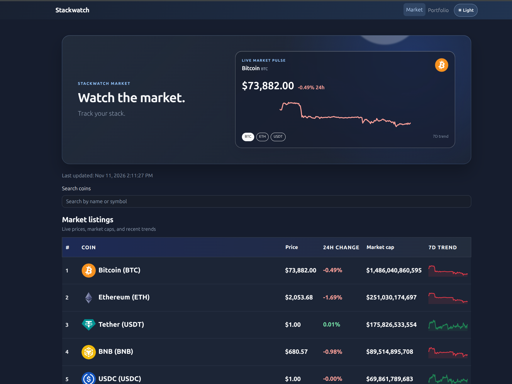
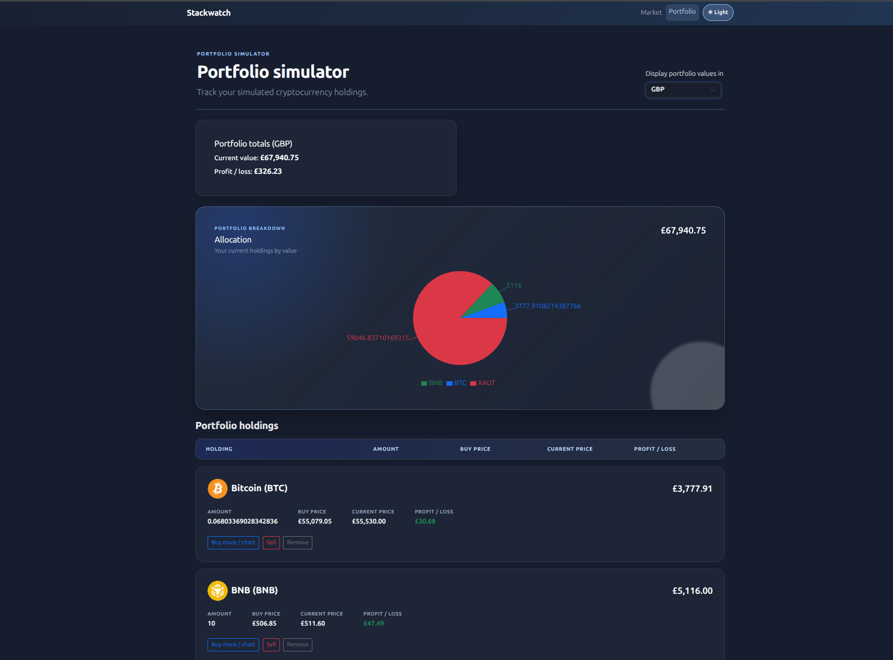
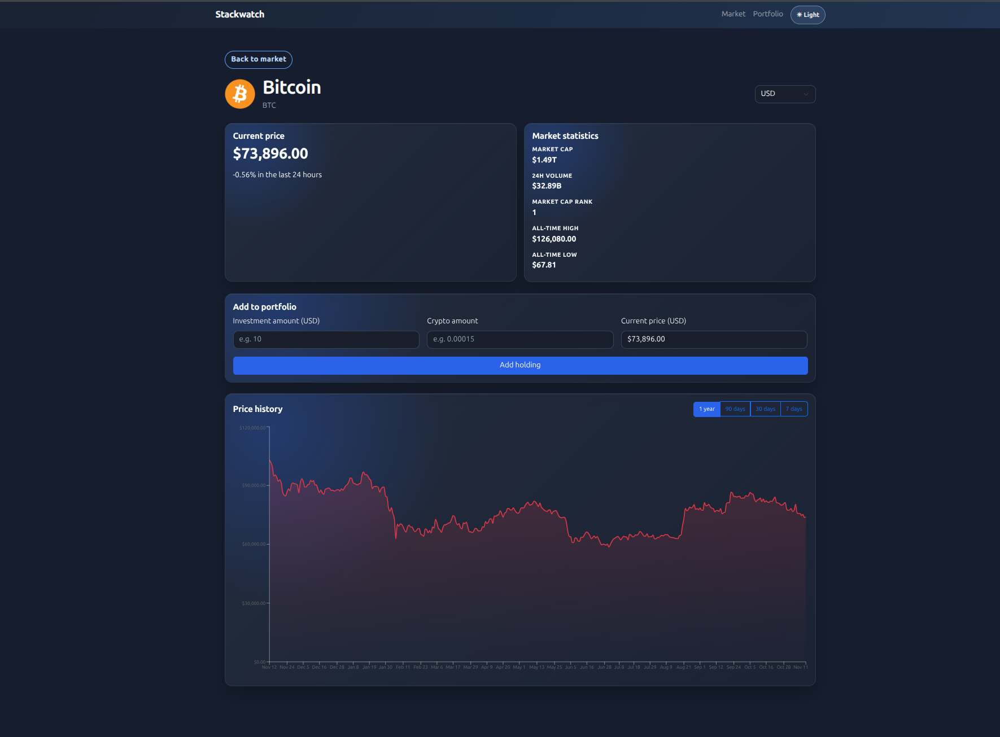

# Stackwatch

Stackwatch is a responsive cryptocurrency market and portfolio tracker.

> Watch the market. Track your stack.

## Features

- View market prices, market caps, and 24-hour changes.
- Search, sort, and refresh market listings.
- Open a coin detail page with market statistics and price history.
- Select 7-day, 30-day, 90-day, or 1-year chart ranges.
- Add, buy more, sell, and remove portfolio holdings.
- Merge repeated purchases of the same coin and currency.
- Track current value, profit/loss, realized profit, and allocation.
- Persist portfolio data and theme preferences in local storage.
- Responsive light and dark themes for desktop and mobile.

## Technologies

- React and Vite
- React Bootstrap and Bootstrap
- Recharts
- date-fns
- react-hot-toast
- CoinGecko API

## Screenshot





## Getting started

### Requirements

- Node.js 20 or later
- npm

### Install and run

```bash
npm install
npm run dev
```

Open the local URL shown by Vite in your browser.

### CoinGecko API key

Copy `.env.example` to `.env` and add a CoinGecko Demo API key:

```bash
cp .env.example .env
```

Then set:

```env
VITE_COINGECKO_KEY=your_demo_key
```

The key is exposed in the browser because this is a frontend-only application. Use only a free Demo key and never commit `.env`.

## Available scripts

```bash
npm run dev      # Start the development server
npm run lint     # Check the source with Oxlint
npm run build    # Create a production build
npm run preview  # Preview the production build locally
```

## Data and storage

Market and coin data come from CoinGecko. The API helper caches repeated requests in memory for 60 seconds and displays loading, error, and empty states.

Portfolio holdings and the selected theme are stored in the browser's local storage. No application backend or user account is required.

## Project structure

```text
src/
  api.js                    CoinGecko requests and caching
  components/               Shared UI components
  context/                  Portfolio state and local storage
  pages/                    Dashboard, coin detail, portfolio, and 404 pages
  App.jsx                   Routes and application shell
```
